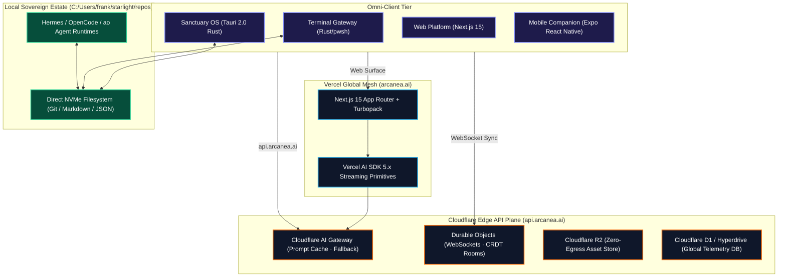
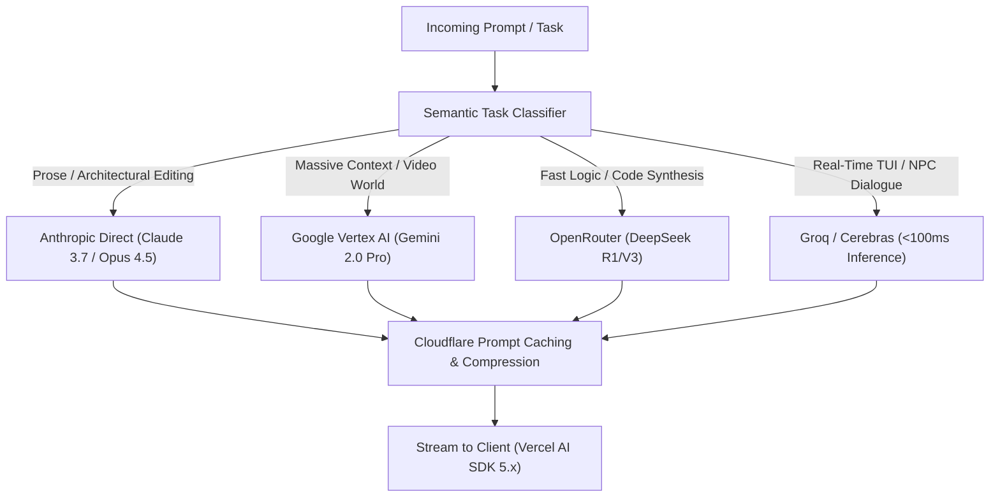

# Architecture Requirements Document (ARD): Arcanea Sovereign Engine

**Document ID:** ARD-ARC-2026-001  
**Status:** APPROVED & LOCKED  
**Lead Architect:** Antigravity / Frank  
**Date:** October 10, 2026  
**Canonical Anchor:** `C:/Users/frank/starlight/repos/arcanea-ecosystem`  

---

## 1. Systems Topology: Two-Tier Edge & Local Substrate

Arcanea rejects monolithic cloud stacks in favor of a **Local-First, Edge-Routed Architecture**:



---

## 2. Technology Selection Rationale

Every library, framework, and partner was selected based on strict criteria: **Latency, Memory Footprint, Sovereignty, and Long-Term Durability**.

```
┌─────────────────────────────────────────────────────────────────────────────┐
│ ✦ TECHNOLOGY STACK SELECTION MATRIX                                         │
├───────────────┬───────────────────────────┬─────────────────────────────────┤
│ LAYER         │ SELECTED TECH             │ WHY SELECTED OVER COMPETITORS   │
├───────────────┼───────────────────────────┼─────────────────────────────────┤
│ Cloud API     │ Cloudflare Workers +      │ • Beats AWS API Gateway on cost │
│ Plane         │ AI Gateway                │ • Sub-10ms edge routing         │
│               │                           │ • Zero-egress bandwidth on R2   │
├───────────────┼───────────────────────────┼─────────────────────────────────┤
│ UI Framework  │ Next.js 15 + React 19     │ • Beats Remix/Vite on streaming │
│               │ + Turbopack               │ • Fluid compute with Server     │
│               │                           │   Components and PPR            │
├───────────────┼───────────────────────────┼─────────────────────────────────┤
│ Desktop Shell │ Tauri 2.0 (Rust)          │ • 35MB RAM vs 900MB Electron    │
│               │ + Webview2                │ • Direct native NVMe file hooks │
│               │                           │ • Native WebGPU & local SLMs    │
├───────────────┼───────────────────────────┼─────────────────────────────────┤
│ Book Engine   │ Typst (Rust Typesetting)  │ • 100x faster than LaTeX        │
│               │                           │ • Native modern programming API │
│               │                           │ • Sub-second print PDF compiler │
├───────────────┼───────────────────────────┼─────────────────────────────────┤
│ Node Graph    │ React Flow + WebGPU       │ • Infinite canvas with spatial  │
│               │ + Headless ComfyUI        │   LOD navigation                │
│               │                           │ • Separation of UI from render  │
├───────────────┼───────────────────────────┼─────────────────────────────────┤
│ 3D Standard   │ OpenUSD (Pixar/NVIDIA)    │ • Universal format across Unreal│
│               │ + Gaussian Splatting      │   Engine 5, Blender, and WebGPU │
│               │                           │ • Zero format fragmentation     │
└───────────────┴───────────────────────────┴─────────────────────────────────┘
```

---

## 3. Data & Storage Architecture

### 3.1 Three-Tier Data Hierarchy
1. **Tier 1: Sovereign Local Disk (SSOT)**:
   * Location: `C:/Users/frank/starlight/repos`.
   * Format: Plaintext Markdown (`.md`), JSON schemas (`.json`), and Git history.
   * Principle: The user owns the raw files. If Arcanea's servers vanish, the user's world remains 100% operational.
2. **Tier 2: Edge Cache & Media Store (Zero Egress)**:
   * Location: Cloudflare R2 + D1.
   * Purpose: Host rendered binary assets (PNG character sheets, MP4 video clips, Suno MP3 audio stems). Zero egress fees prevent bandwidth bankruptcy.
3. **Tier 3: Relational & Vector Memory (SIS & Supabase)**:
   * Location: Supabase PostgreSQL (`pgvector`) + Local SQLite / DuckDB.
   * Purpose: Fast semantic search over world canon, user subscriptions, and marketplace transactions.

---

## 4. Intelligent Model Router Specification (`api.arcanea.ai`)



### 4.1 Routing Policies
* **Latency Priority**: Tasks tagged `#interactive` route exclusively to Groq or Gemini Flash (`TTFT < 150ms`).
* **Depth Priority**: Tasks tagged `#canon` or `#manuscript` route to Claude Opus 4.5 or Claude 3.7 Sonnet.
* **Failover Circuit Breaker**: If upstream returns $5xx$ or timeouts $>3.0\text{s}$, the router automatically retries against the secondary provider in $<150\text{ms}$.
* **Prompt Caching Margin**: Shared world lore prompts are cached at the edge, reducing token costs by $50\%$ while charging creators standard compute rates.

---

## 5. Security & Isolation Architecture

1. **Local-First Privacy Guard**: Client code never transmits raw file paths or unapproved documents.
2. **C2PA Cryptographic Signature Pipeline**: All image and video generations are signed with Arcanea Labs B.V. cryptographic keys embedding manifest provenance.
3. **Zero Secrets in Git**: Enforced via pre-commit hooks running `gitleaks` and Infisical secret management.
