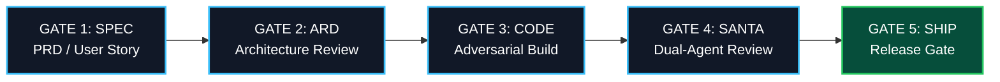

# Software Development Life Cycle (SDLC) & GitHub Operations

**Document ID:** SDLC-ARC-2026-001  
**Status:** APPROVED & LOCKED  
**Standard:** 10 October 2026  
**Canonical Anchor:** `C:/Users/frank/starlight/repos/arcanea-ecosystem`  

---

## 1. The Five-Gate Engineering Life Cycle

Every feature, refactor, and agent capability in the Arcanea constellation must traverse the **Five-Gate SDLC**:



1. **Gate 1: Specification (PRD)**
   * A clear GitHub Issue or Spec file defining the user story, acceptance criteria, and non-functional bounds.
2. **Gate 2: Architecture Review (ARD)**
   * Edge/data contracts defined before implementation. Schema validation files written first.
3. **Gate 3: Adversarial Implementation**
   * Code authored on an isolated branch: `agent/<harness>/<scope>`.
   * Unit tests and typecheck passes must run cleanly in local CI.
4. **Gate 4: The Santa Method Quality Gate**
   * An independent review agent (Aiyami Executive Critic) critiques the code against `TASTE.md`, security boundaries, and performance budgets.
5. **Gate 5: Release & Verification Gate**
   * Pre-landing checks pass: `pnpm type-check`, `pnpm lint`, git hygiene audit. Handover logged to `agentic-ops-hub`.

---

## 2. GitHub Project Board Structure

All Arcanea initiatives are tracked on the unified **GitHub Project Board** across the `frankxai` organization:

```
┌─────────────────────────────────────────────────────────────────────────────┐
│ ✦ GITHUB PROJECT BOARD COLUMNS                                              │
├───────────────┬─────────────────────────────────────────────────────────────┤
│ 1. BACKLOG    │ Raw ideas, customer feedback, candidate world seeds.        │
├───────────────┼─────────────────────────────────────────────────────────────┤
│ 2. IN DESIGN  │ Spec drafting (PRD/ARD), Figma component design, schemas.   │
├───────────────┼─────────────────────────────────────────────────────────────┤
│ 3. IN FLIGHT  │ Active engineering on `agent/<harness>/<scope>` branches.    │
├───────────────┼─────────────────────────────────────────────────────────────┤
│ 4. SANTA GATE │ Code complete; undergoing adversarial red-team review.      │
├───────────────┼─────────────────────────────────────────────────────────────┤
│ 5. SHIPPED    │ Merged to `main`, deployed to Vercel/Cloudflare, verified.  │
└───────────────┴─────────────────────────────────────────────────────────────┘
```

---

## 3. GitHub Issue & Epic Taxonomy

Issues must use strict label and prefix conventions:

| Prefix | Purpose | Example |
|---|---|---|
| `epic/` | High-level initiatives spanning multiple repositories | `epic/router-cloudflare-ai-gateway` |
| `feat/` | New user-facing or platform features | `feat/author-os-typst-pdf-export` |
| `fix/` | Bug fixes and runtime repairs | `fix/status-all-null-path-crash` |
| `sec/` | Red/Blue team security enhancements | `sec/c2pa-media-watermark-pipeline` |
| `perf/` | Latency and memory optimization passes | `perf/tui-startup-sub30ms-optimization` |

### Standard Issue Template
```markdown
### 1. Objective & User Story
As a [persona], I want [capability] so that [outcome].

### 2. Acceptance Criteria
- [ ] Given [condition], when [action], then [outcome].
- [ ] Performance budget: [e.g., latency < 50ms].
- [ ] Zero lint or typecheck regressions.

### 3. Architectural Anchors
- Repositories touched: [e.g., `arcanea-studio`, `arcanea-claw`]
- Standards referenced: `ARD-ARC-2026-001`
```

---

## 4. Branching & Worktree Discipline

* **Default Branch**: `main` (always deployable, protected).
* **Agent Branch Format**: `agent/<harness>/<scope>`
  * Examples: `agent/claude/cloudflare-router`, `agent/gemini/typst-compiler`, `agent/hermes/fleet-task-contract-v1`.
* **Zero Direct Commits to `main`**: All features merge via Pull Request with clean squash or rebase history.
* **Worktree Rule**: Never overwrite or switch branches in a working directory where another agent has an active session. Spawn a git worktree (`git worktree add .worktrees/<scope> <branch>`) for isolated parallel execution.
